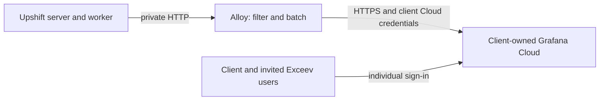

# Client-owned Grafana Cloud with Coolify

Complete the [common client preparation](CLIENT-INSTALLATION.md) first. This option runs Upshift and Alloy on the client's server, with monitoring storage and the Grafana UI in the client's Grafana Cloud stack.



No local Grafana, gateway, Loki, Tempo, Mimir or monitoring S3 service is required. The existing `docker-compose.coolify-monitoring.yml` uses a Bearer token for our gateway; it cannot authenticate to Grafana Cloud just by changing its URL. Generate the separate configuration below.

## 1. Create the client's Cloud organization and stack

1. Have the client create their Grafana Cloud account/organization, retain owner access and choose their billing plan. Agree the region before sending production data.
2. Have the client invite your individual Exceev account. Use the stack role needed for dashboards and support; restrict organization/billing administration to those who need it.
3. In the Cloud Portal, select the client's stack and open **OpenTelemetry → Configure**, or launch Grafana and use **Connections → Add new connection → OpenTelemetry**. Copy its OTLP HTTP endpoint and authentication details. Follow the [official OTLP setup](https://grafana.com/docs/grafana-cloud/send-data/otlp/send-data-otlp/) if UI names have changed.
4. Create a credential restricted to this stack's ingestion, with `metrics:write`, `logs:write` and `traces:write`. Use the OTLP username/instance ID shown by the setup page and the raw token as the password. This is not the client's email/password or a Grafana UI service-account token.
5. Put the following keys in the client's Infisical `/upshift` path and map them in the Coolify application resource.

| Variable | Value |
| --- | --- |
| `GRAFANA_CLOUD_OTLP_ENDPOINT` | Exact HTTPS base endpoint from the stack, typically ending in `/otlp` |
| `GRAFANA_CLOUD_OTLP_USERNAME` | OTLP username/instance ID supplied for that endpoint |
| `GRAFANA_CLOUD_OTLP_TOKEN` | Raw scoped ingestion token, stored as a secret |

Keep `/otlp` when the supplied endpoint includes it. Do not append `/v1/logs`, `/v1/traces` or `/v1/metrics`; the exporter appends each signal path. Do not use a Loki push URL, Prometheus remote-write URL or the Grafana dashboard URL as this endpoint. The credential is separate from our on-premises gateway token.

## 2. Generate the Cloud deployment files

Both files are committed: `upshift/docker/alloy/config.grafana-cloud.alloy` and `upshift/docker/docker-compose.coolify-grafana-cloud.yml`. Run these commands only to regenerate them, from the repository root with Node 22+ and Docker Compose available; neither file contains client secrets. The shared privacy processors remain unchanged, while Cloud uses protobuf OTLP and Basic authentication.

First refresh the base generated Compose:

```sh
node upshift/scripts/render-monitoring-compose.mjs
```

Then derive the Cloud variant:

```sh
node --input-type=module <<'NODE'
import assert from 'node:assert/strict';
import { readFileSync, writeFileSync } from 'node:fs';

let collector = readFileSync('upshift/docker/alloy/config.alloy', 'utf8');
const replaceOnce = (before, after) => {
  assert.equal(collector.split(before).length, 2, `Review changed collector: ${before}`);
  collector = collector.replace(before, after);
};
replaceOnce('encoding = "json"', 'encoding = "proto"');
replaceOnce('sys.env("UPSHIFT_MONITORING_URL")', 'sys.env("GRAFANA_CLOUD_OTLP_ENDPOINT")');
replaceOnce(
  'headers = { "Authorization" = "Bearer " + sys.env("UPSHIFT_MONITORING_TOKEN") }',
  'auth = otelcol.auth.basic.grafana_cloud.handler',
);
collector += `
otelcol.auth.basic "grafana_cloud" {
  username = sys.env("GRAFANA_CLOUD_OTLP_USERNAME")
  password = sys.env("GRAFANA_CLOUD_OTLP_TOKEN")
}
`;
writeFileSync('upshift/docker/alloy/config.grafana-cloud.alloy', collector);

const compose = JSON.parse(readFileSync('upshift/docker/docker-compose.coolify-monitoring.yml', 'utf8'));
const alloy = compose.services.alloy;
alloy.environment = {
  GRAFANA_CLOUD_OTLP_ENDPOINT: '${GRAFANA_CLOUD_OTLP_ENDPOINT:?}',
  GRAFANA_CLOUD_OTLP_USERNAME: '${GRAFANA_CLOUD_OTLP_USERNAME:?}',
  GRAFANA_CLOUD_OTLP_TOKEN: '${GRAFANA_CLOUD_OTLP_TOKEN:?}',
};
alloy.command = [
  'case "$$GRAFANA_CLOUD_OTLP_ENDPOINT" in https://*) ;; *) echo "Cloud OTLP requires HTTPS" >&2; exit 1;; esac\n' +
  'test -n "$$GRAFANA_CLOUD_OTLP_USERNAME" && test -n "$$GRAFANA_CLOUD_OTLP_TOKEN"\n' +
  'exec /bin/alloy run --disable-reporting --server.http.listen-addr=127.0.0.1:12345 /etc/alloy/config.alloy',
];
alloy.volumes = [{
  type: 'bind',
  source: './alloy/config.grafana-cloud.alloy',
  target: '/etc/alloy/config.alloy',
  read_only: true,
  bind: { create_host_path: false },
}];
writeFileSync('upshift/docker/docker-compose.coolify-grafana-cloud.yml', JSON.stringify(compose, null, 2) + '\n');
NODE
```

The top-level Basic-auth fields above match the pinned Alloy `v1.11.3`. When upgrading Alloy, check its [authentication reference](https://grafana.com/docs/alloy/latest/reference/components/otelcol/otelcol.auth.basic/): newer releases prefer `client_auth`. Do not replace the filtering pipeline with a generic full-host collection recipe from the Cloud onboarding screen.

Validate with placeholder credentials; this command checks configuration without sending production data:

```sh
docker run --rm --network none \
  -e GRAFANA_CLOUD_OTLP_ENDPOINT=https://example.invalid/otlp \
  -e GRAFANA_CLOUD_OTLP_USERNAME=123456 \
  -e GRAFANA_CLOUD_OTLP_TOKEN=validation-only \
  -v "$PWD/upshift/docker/alloy/config.grafana-cloud.alloy:/etc/alloy/config.alloy:ro" \
  grafana/alloy:v1.11.3 validate /etc/alloy/config.alloy
docker compose -f upshift/docker/docker-compose.coolify-grafana-cloud.yml \
  config --no-interpolate --no-env-resolution --quiet
```

Review and commit both regenerated files to the deployment branch Coolify reads. The recipe intentionally does not push anything. After changing the shared collector or application Compose sources, regenerate and review this variant again, reapplying any client-specific middleware names or disabled-collection settings.

## 3. Deploy the client resource

1. In the Git Compose resource, use Base Directory `/upshift/docker` and Compose Location `/docker-compose.coolify-grafana-cloud.yml`.
2. Set the application variables from the common guide. Map all three `GRAFANA_CLOUD_OTLP_*` values from this client's Infisical source, including `GRAFANA_CLOUD_OTLP_TOKEN={{vault.GRAFANA_CLOUD_OTLP_TOKEN}}`.
3. Remove unused `UPSHIFT_MONITORING_URL`/`UPSHIFT_MONITORING_TOKEN` mappings for this resource. Do not deploy `upshift/observability/compose.yml` for this option.
4. Allow the collector outbound HTTPS/DNS to the selected Grafana Cloud endpoint. Keep Alloy port 4318 private. Server and worker still export only to `http://alloy:4318`.
5. Deploy the published Upshift image containing the instrumentation. Check Alloy's local Coolify logs for configuration/authentication errors without printing its environment.

## 4. Verify logs, metrics and traces

Sign in to Upshift and perform several normal reads. To make a short acceptance check deterministic, temporarily set `UPSHIFT_TRACE_SAMPLE_RATE=1`, redeploy, perform a harmless request, then restore `0.1`. Allow at least a minute for batches and metric export. Successful `/healthz` checks are intentionally excluded.

In the client's Cloud Grafana, use **Explore** and the stack's managed datasources:

| Signal | Check |
| --- | --- |
| Metrics | In the Prometheus datasource, run `{__name__=~"upshift_.*"}` and confirm recent server/worker process metrics and server request metrics |
| Logs | In the Loki datasource, run `{service_name="upshift-server"}` and inspect a completion record |
| Traces | In the Tempo datasource, search `{ resource.service.name = "upshift-server" }` or paste the trace ID from that log |

Cloud may translate metric names differently from the bundled Mimir version, including counter suffixes. Inspect actual names before saving dashboards. Confirm that a log/trace contains only the approved fields described in [collection scope](README.md#what-is-collected). These checks validate the live Cloud path; local configuration validation alone does not prove successful ingestion.

To reuse `config/grafana/client.json`, import it through **Dashboards → New → Import**. In dashboard settings, clear the `metrics` datasource variable's `/.* metrics$/` regex, select the client's Cloud Prometheus and Loki datasources, and adjust panel queries to the actual metric names from Explore. Save a client-owned copy. The **Upshift monitoring budgets** dashboard is for the self-hosted gateway and will not work here.

Configure a Grafana alert contact point and notification policy for the agreed recipient, send a test notification, and create appropriate application alerts from the metrics verified above. There is no bundled Cloud alert provisioning. For a basic telemetry-loss alert, start with `absent_over_time(upshift_process_uptime_seconds{job="upshift-server"}[10m])` after confirming that exact metric/label exists; also test the alert's No Data behavior. Use an independent availability check if you need to distinguish application failure from collector failure.

## 5. Control usage and maintain ownership

Use the client's Cloud usage/billing pages to monitor active metric series, samples, log ingestion and trace ingestion. Confirm the current plan's allowances and retention at installation time using [Grafana pricing](https://grafana.com/pricing/); a Free plan is not a guaranteed number of Upshift installations. Document the client's actual plan and agree any paid upgrade with them.

Our on-premises **1–2 GiB retained-data budget, disk alerts and gateway cutoff do not apply to Grafana Cloud**. Cloud plan quotas and retention govern that storage. There is no implemented global 2 GiB Cloud switch in this repository. Client-owned accounts separate ownership and usage; they should not be presented as a workaround for provider eligibility rules.

Keep the supplied filtered collection; do not add raw Docker logs, SQL parameters, request bodies or AI prompts. Lower `UPSHIFT_TRACE_SAMPLE_RATE` if successful request volume is excessive. Metrics still emit every 15 seconds, and error records remain eligible; changing an Alloy scrape interval cannot change the application's pushed metric interval. Use Cloud usage controls available to the client's plan and verify their behavior instead of assuming an automatic hard spending cap.

For credential rotation, create a replacement ingestion token, update Infisical, redeploy Alloy, verify all three signals, then revoke the previous token. Track token expiry and retain ownership with the client. Export dashboard JSON and record alert/contact-point settings for recovery. Switching to on-premises moves new writes only; Cloud history remains subject to the client's plan and deletion policy.

## Troubleshooting

| Symptom | Check |
| --- | --- |
| HTTP 401/403 | OTLP username, raw token, token expiry, write scopes and correct stack. Do not send a Bearer token or pre-encoded Basic header in the password field |
| HTTP 404 | Exact OTLP base endpoint, including `/otlp` where supplied; check for accidentally repeated `/v1/...` |
| HTTP 429 | Cloud usage/ingestion limits and local queue drops; bounded retries do not preserve an unlimited backlog |
| Metrics but no request logs/traces | Generate eligible requests; check sampling and time range. Health checks and worker jobs are not request telemetry |
| Nothing exported | Confirm the image contains the preload, both services have collection enabled, Alloy started, and outbound TLS/DNS works |
| Empty dashboard with data in Explore | Datasource variable regex, selected datasource and Cloud metric-name translation |

The Cloud recipe can be validated locally, but first use still requires the client's real stack and ingestion acceptance checks. No Cloud account is created or live deployment performed by following repository-only validation commands.
