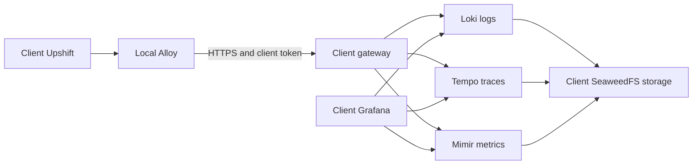

# Dedicated on-premises Grafana stack with Coolify

Complete the [common client preparation](CLIENT-INSTALLATION.md) first. This guide gives one client their own monitoring stack and Grafana access. It can run on their application server for a small installation, or on a separate client-owned monitoring server to isolate resource usage.



This installs a new dedicated Grafana with its required backends. An existing Grafana + InfluxDB deployment can remain separate. Reusing that Grafana instead requires private connectivity, datasource provisioning and access review; the supplied Compose does not automatically attach to it.

## 1. Prepare the server and domains

Choose capacity after measuring the client's workload. This is a single-node stack without high availability; a larger budget alone does not make it redundant. Leave memory/CPU for all eight long-running monitoring services, their WALs/caches and the Upshift/database workload. The tenant's 2 GiB object budget is not a 2 GiB server disk requirement.

Prepare two HTTPS domains, for example:

- `grafana.client-domain.com`: human access to Grafana, port **3000**.
- `monitoring.client-domain.com`: authenticated ingestion gateway, port **8080**.

Use internal DNS and a trusted certificate/CA if the installation must stay on a private network. Ensure Alloy trusts that CA; the supplied configuration assumes certificates trusted by the container. Do not disable TLS verification. No public domain is needed for Alloy, storage, Loki, Tempo, Mimir, Prometheus, Alertmanager or gateway port 9090.

## 2. Create the client credential and monitoring secrets

From the repository root:

```sh
node upshift/observability/gateway/config.mjs client-a
```

This prints `client.UPSHIFT_MONITORING_TOKEN` and a `centralTenant` object containing the tenant ID, token hash and `budgetBytes`. Use a short nonpersonal identifier. Store the token in the client's Infisical `/upshift` path; store **an array containing only the `centralTenant` object** as `MONITORING_TENANTS_JSON` in `/monitoring`.

The resulting shape is:

```json
[
  {
    "id": "client-a",
    "tokenSha256": "<actual 64-character hash printed by the command>",
    "budgetBytes": 2147483648
  }
]
```

Replace the placeholder before use. `2147483648` is 2 GiB; use `1073741824` for 1 GiB. Configure only this client's tenant in a dedicated installation.

Create the monitoring resource secrets in the same client's Infisical project, `/monitoring` path:

| Variable | Value and destination |
| --- | --- |
| `S3_ACCESS_KEY_ID` | Unique storage credential identifier; monitoring resource only |
| `S3_SECRET_ACCESS_KEY` | Strong random storage password; monitoring resource only |
| `GRAFANA_ADMIN_PASSWORD` | Strong random initial administrator password |
| `MONITORING_TENANTS_JSON` | Actual JSON array described above, not the whole command output |
| `ALERT_WEBHOOK_URL` | HTTPS receiver accepting Alertmanager webhook JSON |

Set nonsecret `GRAFANA_ADMIN_USER` (default `admin`) and `GRAFANA_URL=https://grafana.client-domain.com` in Coolify. The included storage service speaks the S3 protocol on the client's disk; these are **local SeaweedFS credentials**, not AWS keys and not Upshift attachment-storage credentials.

Use a separate read-only Infisical machine identity for `/monitoring`. Attach it to the monitoring Coolify resource and map secrets with `{{vault.KEY}}`. The application resource continues to read `/upshift`; it does not need the storage keys or Grafana admin password.

`ALERT_WEBHOOK_URL` is not a plain Slack webhook. If you want Slack/email/another provider directly, adapt `config/alertmanager.yml` using that receiver's supported configuration and validate it before deployment. Do not leave a dummy URL in production.

## 3. Deploy the monitoring backend

1. Create a **Git Docker Compose application** on the client's Coolify server, using this repository and the intended revision.
2. Set Base Directory `/upshift/observability` and Compose Location `/compose.yml`. Keep the Git checkout: gateway builds and bind-mounted configuration depend on it.
3. Attach the monitoring Infisical source, map the variables above, and configure only the two domain routes: `grafana` on port 3000 and `gateway` on port 8080.
4. Check the resolved Compose project/volume names. `compose.yml` contains `name: upshift-monitoring`; when multiple dedicated stacks share one Docker host, give each an explicit unique project name in its deployment configuration and confirm Coolify's resolved names. Never let two client stacks share storage volumes or networks unintentionally.
5. Deploy. The one-shot `buckets` service should exit successfully; it creates buckets before Loki/Tempo/Mimir start. The gateway must become healthy before Grafana starts. Preserve named volumes on every subsequent redeployment.
6. Sign in to Grafana over HTTPS. Verify **Monitoring infrastructure**, `client-a logs`, `client-a traces` and `client-a metrics` datasources, and the **Upshift monitoring budgets** and **Upshift client operations** dashboards.

Create an individual client administrator account and an Exceev support account with the agreed role. This dedicated organization contains only the client's data. Do not invite clients into a shared Exceev organization containing other tenants: Grafana OSS datasource access is organization-wide, and a dashboard filter is not an authorization boundary. See the [Grafana datasource access documentation](https://grafana.com/docs/grafana/latest/administration/data-source-management/).

The initial admin-password environment variable is used to initialize a fresh Grafana database. Updating it in Infisical does not change an already-created user's password; rotate that password through Grafana's supported administration flow. Plan storage credential rotation separately as well.

## 4. Connect the Upshift application

In the client's application resource:

1. Use Base Directory `/upshift/docker` and Compose Location `/docker-compose.coolify-monitoring.yml`.
2. Set `UPSHIFT_MONITORING_URL=https://monitoring.client-domain.com`, with **no** `/otlp` or `/v1/...` suffix. This is our gateway origin, unlike Grafana Cloud's endpoint path.
3. Map `UPSHIFT_MONITORING_TOKEN={{vault.UPSHIFT_MONITORING_TOKEN}}` from `/upshift`.
4. Set `UPSHIFT_OBSERVABILITY_ENVIRONMENT=production` and start with `UPSHIFT_TRACE_SAMPLE_RATE=0.1`.
5. Preserve all application/database/storage variables from the common guide, pin the newly published instrumented image and deploy.

Server and worker send to Alloy at `http://alloy:4318`. Alloy sends filtered records to the gateway over HTTPS. The gateway authenticates the token and inserts the tenant header; callers cannot select another client by changing a label or header.

## 5. Prove ingestion and notifications work

1. Perform normal harmless Upshift requests. For a brief deterministic check, temporarily set success sampling to `1`, redeploy, make a request, then return to `0.1`. Health checks are omitted.
2. In Grafana Explore, select `client-a metrics` and query `{__name__=~"upshift_.*"}`. Allow at least a minute; verify recent server/worker process data and server request counters.
3. Select `client-a logs`, query `{service_name="upshift-server"}`, and copy a record's trace ID. Look it up in `client-a traces`. Verify the request body, raw URL/query, user information and arbitrary exception text are absent.
4. In the operations dashboard select the matching client metrics and logs datasources. In the budget dashboard check inventory freshness, disk usage, ingestion outcomes and the client's configured budget. Object usage can initially remain zero until backends flush; it is not a count of every accepted byte.
5. Send an agreed synthetic alert to the private Alertmanager API from its network, using the runbook below. Confirm delivery to the real receiver. This tests the routing and recipient separately from Prometheus rule evaluation.

For an authorized notification test, execute inside the **gateway** container terminal in this monitoring resource:

```sh
node --input-type=module <<'NODE'
const response = await fetch('http://alertmanager:9093/api/v2/alerts', {
  method: 'POST',
  headers: { 'Content-Type': 'application/json' },
  body: JSON.stringify([{
    labels: { alertname: 'UpshiftInstallationTest', severity: 'warning', client: 'client-a' },
    annotations: { summary: 'Agreed Upshift installation notification test' },
    startsAt: new Date().toISOString(),
    endsAt: new Date(Date.now() + 120_000).toISOString(),
  }]),
});
if (!response.ok) throw new Error(`Alert test rejected: ${response.status}`);
console.log('Test alert accepted; confirm receipt with the notification recipient.');
NODE
```

Replace `client-a` with the installation's ID. Expect a notification and potentially a resolved notification, subject to the receiver's grouping settings. Do not expose Alertmanager publicly to run this test.

## 6. Set retention, limits and disk alerts

The defaults and their authoritative files are:

| Control | Default | File |
| --- | --- | --- |
| Logs | 7 days | `config/loki.yml` |
| Traces | 3 days | `config/tempo.yml` |
| Metrics | 30 days | `config/mimir.yml` |
| Combined attributed object budget | 2 GiB per client | `MONITORING_TENANTS_JSON` |
| Shared ingestion rate | 128 KiB/s, 1 MiB burst per client | `gateway/gateway.mjs` |
| Disk warning/critical | 70% for 10 minutes / 85% for 5 minutes | `config/alerts.yml` |
| Global ingestion brake | 90% of measured storage filesystem | `gateway/gateway.mjs` |

The 1–2 GiB budget is **retained storage, not per day**. It is soft: it counts attributed objects across Loki/Tempo/Mimir and recognized tenant indexes, excluding WAL/cache/shared storage overhead. Data accepted before an asynchronous flush can overshoot. At 100%, that tenant's new telemetry receives 429 until normal retention reduces usage. The application keeps working; bounded queues eventually discard telemetry. There is no automatic history-shortening controller.

At 70%/85%, act before the cutoff: investigate traffic/errors, lower successful-request sampling or provide more capacity. For lasting policy changes, edit the versioned backend retention settings and validate them with the pinned binaries. Retention is asynchronous; Loki's changed retention policy is not retroactive for existing data. Never delete object files or indexes manually to free space. See the [budget and disk runbooks](README.md#runbooks).

The disk alert measures the filesystem backing the object-storage volume. If other WAL/data volumes live on separate disks, add monitoring for those disks too. A complete monitoring-host outage cannot report through its own stopped Alertmanager; use an independent availability monitor for that failure mode.

## 7. Backups, updates and handover

Record named volumes and plan backups of Grafana state, monitoring configuration, Infisical recovery material and any history the client needs to retain. For a simple single-node consistent backup, schedule downtime, stop the monitoring writers/backend stack without removing volumes, snapshot or back up all related volumes together, and restart in dependency order. New telemetry may be lost during this window. Do not assume copying a live S3 directory alone is a complete restore plan.

Restore first to an isolated environment with ingestion credentials disabled/replaced, verify datasources/dashboards and retained records, and record the restore procedure and date. Keep application/database backups independent of monitoring backups.

Upgrade pinned component images intentionally and run the [local validation commands](README.md#validation-and-maintenance). The Docker smoke test uses disposable resources; it does not prove a client's restore or production network. Before production rollout, back up data and review backend upgrade compatibility. Do not roll database/image versions backwards without a supported recovery plan.

For gateway-token rotation, update the tenant hash and redeploy gateway, update the client's Infisical token and redeploy Alloy, then verify ingestion. This single-token flow can briefly lose telemetry. After tenant changes, restart Grafana to reload generated datasources. For a dedicated stack, the client should retain administrator and recovery access after Exceev is removed.
