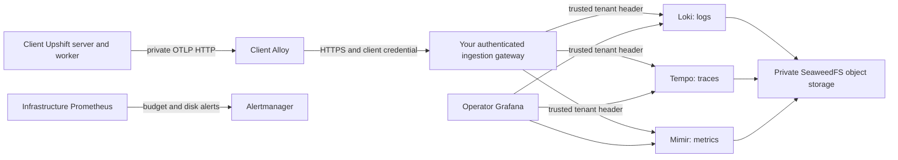

# Self-hosted monitoring with Coolify and Infisical

For a new client installation, start with the [client installation guide](CLIENT-INSTALLATION.md), then choose [client-owned Grafana Cloud](GRAFANA-CLOUD.md) or [dedicated on-premises Grafana](ON-PREMISE.md). This page describes the self-hosted backend and its operator runbooks; the Cloud option has different authentication and storage limits.

This is an optional, single-server monitoring deployment for Upshift. It sends operational data to your own infrastructure. It does not enable Twenty telemetry, enterprise callbacks, browser analytics, Sentry or the upstream remote metric exporter. Existing images do not acquire this instrumentation: build and publish a new Upshift image from this branch, then pin its tag or digest in each client resource.



## What is collected

- Server HTTP completion logs with a constant message, method, coarse route bucket, status, duration and locally generated trace/span IDs.
- One real server request span per sampled request. Successful requests default to 10% sampling; HTTP errors are kept subject to bounded queues and ingestion limits. Successful health and metric requests are omitted.
- Cumulative request counts and duration histograms, process RSS and uptime for server/worker. Metrics count all eligible requests, independently of sampling.

No request/response bodies, raw URLs, query strings, headers, cookies, SQL parameters, AI prompts/output, free-form exception messages, email addresses or user IDs are exported by this instrumentation. It does not collect raw Docker/stdout logs. Resource dimensions are service and environment; method, coarse route and status class are bounded metric dimensions. Trace IDs are fields, never metric labels or Loki index labels. Tenant identity comes from the gateway credential, not a caller label.

This is deliberately limited instrumentation: it does not capture browser errors, job execution/failures, database/outbound dependency spans, GraphQL resolver timing or exceptions inside a successful HTTP 200 response. Worker coverage is process metrics. Local application logs remain available in Coolify. The current cumulative metrics assume one server and one worker per deployment; add a reviewed bounded replica dimension before scaling them horizontally.

Instrumentation is disabled unless explicitly enabled and configured with a local collector origin. The supplied overlay uses `http://alloy:4318`; the application cannot be pointed directly at a public telemetry endpoint. Gateway ingestion accepts JSON OTLP only. It rebuilds approved records from an allowlist, strips unknown fields and overwrites the tenant header. The collector is private and has no published port or Docker socket.

## Files and defaults

| File | Purpose |
| --- | --- |
| `compose.yml` | Central services, persistent volumes, private backend network |
| `config/*.yml` | Retention, backend limits, infrastructure scraping and alerts |
| `client/config.alloy` | Client filtering, batching and bounded export queue |
| `../docker/docker-compose.coolify-monitoring.yml` | Complete client Compose definition for Coolify, generated from the base and overlay |
| `../docker/docker-compose.monitoring.yml` | Optional overlay for ordinary Compose |
| `gateway/config.mjs` | Tenant credential generator and datasource provisioning |

| Setting | Default |
| --- | --- |
| Loki log retention | 7 days |
| Tempo trace retention | 3 days |
| Mimir metric retention | 30 days |
| Infrastructure Prometheus retention | 7 days / 1 GB, whichever limit is reached first |
| Combined per-client retained object budget | 2 GiB = 2,147,483,648 bytes |
| Gateway per-client ingestion | 128 KiB/s, 1 MiB burst, shared across all signals |
| Largest decoded request | 1 MiB, including gzip expansion limit |
| Concurrent gateway requests | 4/client, 32 total |
| Mimir active series | 5,000/client |
| Loki active streams | 100/client |
| Alloy export queue | 16 batches, bounded retries for 60 seconds; memory limiter 128 MiB |
| Storage scan | Every 60 seconds; close ingestion if older than 180 seconds |

Use `budgetBytes: 1073741824` for 1 GiB. These are **retained-data budgets, not daily allowances**. They are soft limits: the meter sums tenant-attributed object sizes across the three buckets, including recognized Loki tenant indexes. In-memory data, WALs, local indexes/caches, object-store allocation/compaction and shared metadata are not attributable to a tenant. Backends flush asynchronously; already accepted data can push measured usage above the budget. The dashboard exposes unattributed objects separately. Budgeting does not reserve or limit filesystem space per client.

At 70%/85%, alerts ask you to reduce sampling or add capacity. At 100% of a client's measured budget, the gateway responds 429 for all that client's new telemetry. It resumes after normal backend retention brings usage below budget. There is no replay promise: bounded client queues eventually discard data. The application continues working. At 90% of the storage filesystem, ingestion stops globally with 503. This is an emergency brake; keep free capacity for WAL and compaction. No process manually deletes backend files or dynamically shortens retention.

## Central Coolify resource

1. Create a Git-based **Docker Compose application** from this repository and branch. Set Base Directory to `/upshift/observability` and Compose Location to `/compose.yml`. Keep the checkout available: this stack builds the small gateway and mounts versioned configuration files. A raw pasted Compose service alone does not contain those files.
2. In Infisical, create `exceev-monitoring`, environments `staging`/`prod`, and path `/monitoring`. Add the central secrets listed below. Create a machine identity restricted to reading this project/environment/path.
3. In Coolify, register that identity under **Keys & Tokens → Integration Tokens → Infisical**, with its base URL and Universal Auth client credentials. On the monitoring resource, select it under **Environment Variables → Secret manager**, then select project ID, environment slug and path.
4. Set secret values as `{{vault.KEY}}` in Coolify. The placeholder is `vault` even for Infisical. Set the nonsecret `GRAFANA_URL` to your HTTPS Grafana origin. Configure HTTPS domains for **grafana port 3000** and **gateway port 8080** only. Do not expose storage, query backends, Prometheus, Alertmanager or gateway port 9090.
5. Deploy. Open Grafana, verify the **Upshift monitoring budgets** dashboard and the per-client datasources. Verify a test alert reaches your webhook receiver before enabling customer collectors.

| Central variable | Where/value |
| --- | --- |
| `S3_ACCESS_KEY_ID` | Infisical; private object-storage credential identifier |
| `S3_SECRET_ACCESS_KEY` | Infisical; strong random storage password |
| `GRAFANA_ADMIN_PASSWORD` | Infisical; strong random initial administrator password |
| `MONITORING_TENANTS_JSON` | Infisical; JSON array from the tenant generation step below |
| `ALERT_WEBHOOK_URL` | Infisical; HTTPS receiver accepting Alertmanager webhook JSON |
| `GRAFANA_ADMIN_USER` | Coolify; default `admin` |
| `GRAFANA_URL` | Coolify; e.g. `https://grafana.example.com` |

`ALERT_WEBHOOK_URL` is not a plain Slack incoming-webhook URL; use an Alertmanager-compatible receiver or adapt `config/alertmanager.yml` for your notification provider. The supplied local test verifies webhook delivery without sending an external notification.

For a shared central deployment, Grafana is **operator-only**. Grafana OSS datasource visibility is organization-wide: do not give customers accounts in the central operator organization. Customer-facing access needs separate organizations with only that customer's datasources and separately tested authorization. A dedicated client deployment can give that client direct access because it contains only their data; follow the [on-premises guide](ON-PREMISE.md).

Backend services use a Docker `internal` network. Gateway, Grafana and Alertmanager also join the Coolify-facing/default network. Only the selected domains should be routed. All components with usage reporting controls have reporting disabled; Grafana plugin preinstallation and update checks are disabled too. SeaweedFS's additional web interfaces are private and its admin/WebDAV/Iceberg services are disabled. Storage credentials are currently shared by backend services, including the inventory reader; keep them in the monitoring resource, never in the application or Alloy resource. In a dedicated installation, that backend runs on the client's server. The stack is a single-node deployment, not highly available.

## Add a client

Run locally from the repository root (Node 22+):

```sh
node upshift/observability/gateway/config.mjs client-a
```

The command prints a new random ingestion token and a central tenant entry with its SHA-256 hash. Store `client.UPSHIFT_MONITORING_TOKEN` in **that client's** Infisical project. Append only `centralTenant` to the central `MONITORING_TENANTS_JSON` array. Do not paste the token into Git, a ticket or a shared chat. Tenant IDs must be short lowercase identifiers, never a person's email. Restart/redeploy the gateway to load the new array, then restart Grafana to reload datasource provisioning.

For the client in Coolify:

1. Use one Infisical project per client, such as `upshift-client-a`, with scoped `prod`/`staging` environments and a read-only machine identity. Strict on-premises customers can own their Infisical organization/instance and their monitoring stack.
2. Use a Git Docker Compose resource with Base Directory `/upshift/docker` and Compose Location `/docker-compose.coolify-monitoring.yml`. This generated file contains the existing server/worker services plus Alloy. It expects your existing PostgreSQL and Redis resources, just like the base compose file.
3. Attach that client's Infisical source and map the existing Upshift secret variables plus `UPSHIFT_MONITORING_TOKEN` using `{{vault.KEY}}`. Set `UPSHIFT_MONITORING_URL` to your gateway's **HTTPS origin**, without `/v1/...`; set `UPSHIFT_OBSERVABILITY_ENVIRONMENT=production` and optionally `UPSHIFT_TRACE_SAMPLE_RATE=0.1` in Coolify.
4. Set `TAG` to the newly published image from this branch (prefer an immutable release/digest). Preserve the existing Upshift domain/Traefik settings and DB/storage settings. Deploy and check all three datasources for the client.

The monitoring compose enables `UPSHIFT_OBSERVABILITY_ENABLED=true` explicitly for server and worker. The ordinary `docker-compose.yml` remains monitoring-free. To disable export, return to the base compose or edit the selected Compose file to set this flag false for both services; a same-named Coolify variable does not override the literal value. Remove Alloy if no longer used. For fully local monitoring, deploy the central stack on that client's server and point their collector at its local HTTPS gateway domain with only that client's tenant configured.

**Preserve existing `ENCRYPTION_KEY` and `SERVICE_BASE64_32_SECRET` when moving them into Infisical.** The latter becomes `APP_SECRET`. Do not regenerate existing application or database secrets as part of adoption. Infisical reduces repeated entry; it does not rotate database credentials automatically. Grafana's admin-password environment variable initializes a new database; changing it does not reset an existing Grafana user's password. SeaweedFS initial credentials also need a planned rotation for existing data.

Coolify supports one secret source per resource. A Compose stack can share that source, so server and worker reuse the same client secrets without duplicate entries. Secrets are fetched at deployment/startup, so changing Infisical requires restart/redeploy. Runtime credentials still exist on the host/container. Keep shared nonsecret defaults in Coolify and retention/filter/alert configuration in Git.

## Runbooks

### Client budget warning or cutoff

Check the client/signal panels and ingestion outcome. Lower `UPSHIFT_TRACE_SAMPLE_RATE` for that client and redeploy; HTTP errors and metrics remain until an ingestion limit is reached. Check for repeated errors generating useful but excessive volume. If needed, increase that client's `budgetBytes` with sufficient whole-server capacity. Retention changes affect future policy and are asynchronous; **Loki does not retroactively apply a shorter retention period to already-ingested data**. A full client may temporarily lose all new monitoring until normal expiry frees space. Do not delete object files, WALs or indexes manually.

### Disk pressure

Warn at 70% for 10 minutes; critical at 85% for 5 minutes. The gateway uses `statfs` on the actual object-storage volume, so the signal includes everything on that backing filesystem, not just the three tenant buckets. The provided named volumes normally share the Docker data filesystem. If you move backend WAL or other volumes to different filesystems, add monitoring for those filesystems too.

At critical pressure, add/expand storage or reduce collection before the 90% brake. Inspect Docker log growth and unrelated workloads through Coolify. The supplied monitoring definitions rotate each container’s local logs at 10 MiB × 3 files; verify equivalent rotation for other host resources; application console logs are not included in the per-client object budget. Retention/compaction takes time and needs spare disk. Do not remove backend directories manually.

### Stale inventory / ingestion failures

Check the gateway and object-storage container health and local logs. Validate S3 credentials and bucket availability. The gateway retains the last successful scan, closes ingestion after 180 seconds without a complete scan, and reopens after a successful refresh. `backend_rejected` means the downstream service refused data; inspect that backend, its active-series limits and readiness. `rate` means the client exceeded the shared decoded-byte rate; reduce sampling or explicitly revise the gateway constant and capacity plan.

### Credential rotation / removal

Generate a new client token, replace the hash in the central tenant record and redeploy gateway, then update the client's secret and redeploy Alloy. Brief export failures are expected during this single-token rotation. Removing a tenant stops new writes and removes provisioned datasources on the next Grafana provisioning reload; it does not erase stored data. Leave a retired tenant entry with an unusable random hash if you still need to account for its retained data. Existing records expire through normal retention. Preserve volumes when redeploying.

## Validation and maintenance

```sh
node --test upshift/observability/instrumentation/*.test.mjs upshift/observability/gateway/*.test.mjs upshift/scripts/observability-patches.test.mjs
node upshift/scripts/render-monitoring-compose.mjs --check
node upshift/observability/test/smoke.mjs
```

The smoke test creates uniquely named Docker resources and disposable credentials, validates Alloy/Prometheus/Alertmanager with their pinned binaries, sends a real instrumented HTTP request through Alloy and the gateway, queries all three backends, verifies another tenant cannot see it, checks Grafana provisioning and delivers a synthetic alert to a local sink. It removes only its own test volumes afterwards. It does not build the full Upshift image or contact a live Coolify instance.

After editing either client compose source, regenerate the Coolify file with `node upshift/scripts/render-monitoring-compose.mjs`. Its JSON serialization is valid YAML and preserves variable placeholders. Image versions are pinned; upgrade them intentionally and rerun the integration test. Back up Grafana state, configuration/Infisical secrets and persistent data as required; test restores separately.

Reference documentation: [Coolify Compose](https://coolify.io/docs/applications/builds/docker-compose), [Coolify secret sources](https://coolify.io/docs/integrations/security/using-secret-managers), [Loki retention](https://grafana.com/docs/loki/latest/operations/storage/retention/), [Mimir retention](https://grafana.com/docs/mimir/latest/configure/configure-metrics-storage-retention/), [Grafana datasource access](https://grafana.com/docs/grafana/latest/administration/data-source-management/), [SeaweedFS](https://github.com/seaweedfs/seaweedfs).
